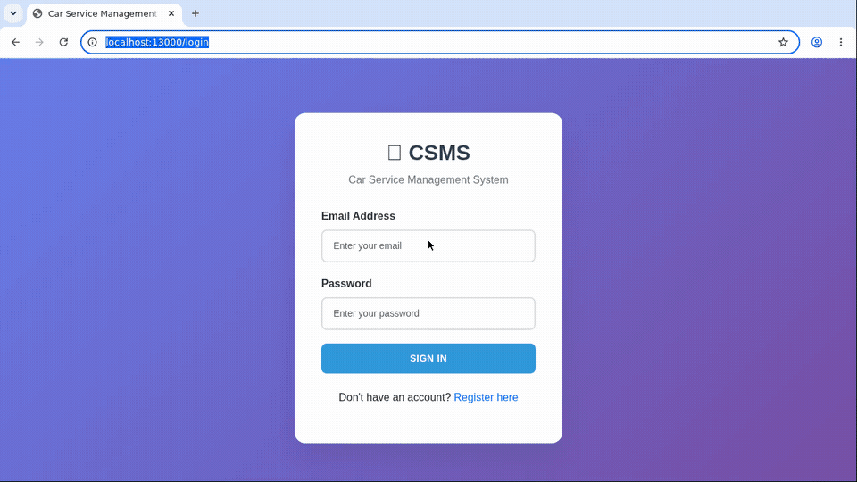

# Car Service Management System

A learning project I built to practise full-stack development. Customers register their cars and raise service requests; staff move each request through pending, in progress and completed. There are two backend implementations of the same app - pick one:

| Path | What it is |
| --- | --- |
| `frontend/` | React 18 frontend (Vite) |
| `backend/` | Node/Express demo backend, data kept in memory |
| `backend-java/` | Java 17 / Spring Boot backend with MySQL |
| `docs/` | Java API reference and old controller sketches |

The Node backend is the quick way to see the app running.

 The Java backend is the same domain model built with Spring Data JPA, JWT security and MySQL, and is what I use to talk about the Java side.

## Run the demo (Node + React)

Needs Node.js 20 or 22.

```sh
cd backend
npm ci
JWT_SECRET=$(openssl rand -hex 32) npm start
```

In a second terminal:

```sh
cd frontend
npm ci
npm run build
npm run preview
```

Open http://localhost:3000. The preview server proxies `/api` calls to the backend on port 8080. For frontend development, `npm run dev` starts Vite with the same proxy.

Demo logins (all use the public demo password `password123`):

- `john.anderson@email.com` - customer
- `robert.taylor@email.com` - admin

The demo backend keeps its data in memory, so every restart reseeds the sample users, cars and requests.

## How it fits together

- Log in and the backend returns a JWT; the React app stores it and sends it as a bearer token on every request.
- The backend checks the token on all `/api` routes. Admin-only routes (dashboard overviews, user deletion, request status changes) also check the role. Customers can only read and change their own cars, requests and profile.
- Registering always creates a customer account; the two admin accounts come from the seed data.
- `backend/src/` is split into the in-memory store, the seed data, the auth middleware and one route module per resource.

## Java + MySQL version

Needs Java 17, Maven and a local MySQL database named `car_service_db`.

```sh
cd backend-java
DB_USERNAME=root DB_PASSWORD=... JWT_SECRET=$(openssl rand -hex 32) mvn spring-boot:run
```

It serves the same frontend (`frontend/`); the endpoints are listed in `docs/java-api.md`. Tables are managed by Hibernate (`ddl-auto=update`), so point it at a scratch database. There is also a `docker-compose.yml` that brings up MySQL, this backend and the frontend together; it expects `MYSQL_ROOT_PASSWORD`, `DB_PASSWORD` and `JWT_SECRET` in the environment.

## Known limits

- This is a local learning demo, not something to expose on the internet. CORS is open, the demo password is public, and the Node backend forgets everything on restart.
- Invoice, report, settings and notification features were sketched but never finished; the drafts live in `docs/incomplete-java-controller-examples/` and are not wired in.
- `npm audit` currently flags a ReDoS issue in `picomatch`, a build-time dependency of Vite, with no fixed release yet. It only affects the dev tooling, not the built app.
